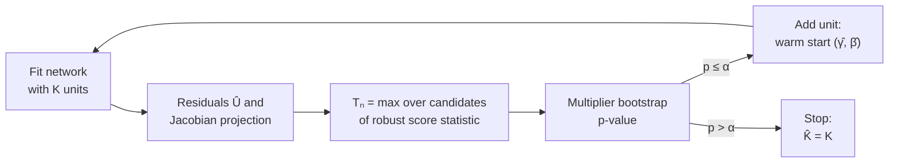

<p align="center">
  
</p>

<p align="center">
  <a href="https://colab.research.google.com/github/yamenetoo/sup-score-growth/blob/main/notebooks/supgrow_colab.ipynb"></a>
  
  
  
  <a href="LICENSE"></a>
</p>

# supgrow — when should a neural network grow?

**supgrow** turns the decision to add a hidden unit to a neural network into a **statistical hypothesis test** with a known error rate.

Growing (constructive) methods such as GradMax, Firefly or NORTH* add a unit when a gradient-based signal exceeds a hand-set threshold. That threshold has no stated error rate, and the right value changes with the sample size. supgrow replaces it with a **sup-score (Lagrange multiplier) test**. The test is calibrated by a **multiplier bootstrap**, so a unit is added only when the data show that the current network is too small.

* **When to grow:** the test of $H_0$: *"$K$ hidden units are enough"*. Applied sequentially, it selects the true number of units with probability tending to $1-\alpha$.
* **Where to grow:** a vector form of the test with a Bonferroni rule chooses the layer of a deep network that should receive the next unit.
* **How to start the new unit:** the maximising candidate weights and the one-step coefficient give a warm start for the new unit.

Code by **Mohamad Yamen AL Mohamad** (Department of Statistics, University of Tabriz), accompanying the article *"When Should a Neural Network Grow? A Sup-Score Test for Adding Hidden Units"* (in preparation).

---

## Contents

- [The idea in one picture](#the-idea-in-one-picture)
- [Installation](#installation)
- [Quick start](#quick-start)
- [Run on Google Colab](#run-on-google-colab)
- [Reproducing the experiments](#reproducing-the-experiments)
- [Main findings](#main-findings)
- [Package layout](#package-layout)
- [Citation](#citation) · [License](#license)

---

## The idea in one picture

For a network with $K$ tanh units, $f_K(\mathbf x;\boldsymbol\theta)=c+\sum_{k=1}^K a_k\tanh(\mathbf w_k^\top\tilde{\mathbf x})$, adding a unit with weights $\boldsymbol\gamma$ and output weight $\beta$ helps only if the residuals are correlated with $\tanh(\boldsymbol\gamma^\top\tilde{\mathbf x})$. The weights $\boldsymbol\gamma$ are not identified under $H_0$ (the Davies problem), so the test takes the supremum over a grid of candidates:

$$
T_n=\max_{\boldsymbol\gamma\in\Gamma}\ \frac{\Big(\sum_i \hat U_i\,\tilde g_i(\boldsymbol\gamma)\Big)^2}{\sum_i \hat U_i^2\,\tilde g_i(\boldsymbol\gamma)^2},
$$

Here $\hat U_i$ are the residuals of the current fit and $\tilde g_i$ is the candidate unit after projection on the Jacobian of the network, with a heteroskedasticity-robust variance in the denominator. The critical value comes from the multiplier bootstrap, which re-weights the residuals with $N(0,1)$ multipliers without refitting.



The numerator of $T_n$ is the gradient criterion used by GradMax-type methods. supgrow therefore keeps their signal and supplies the missing calibration.

## Installation

```bash
git clone https://github.com/yamenetoo/sup-score-growth.git
cd sup-score-growth
pip install -e .            # core package
pip install -e ".[cnn]"     # + torchvision, for the CNN experiment
```

Requirements: Python ≥ 3.9, PyTorch ≥ 2.0 (CUDA optional), NumPy, SciPy, pandas, Matplotlib, scikit-learn.

## Quick start

```python
import numpy as np
from supgrow import grow, sup_score_test

# data from a network with two tanh units
rng = np.random.default_rng(0)
X = rng.standard_normal((500, 2))
xt = np.c_[np.ones(500), X]
y = 1.5*np.tanh(xt @ [0, 1, .5]) - np.tanh(xt @ [.5, -.5, 1.5]) + 0.5*rng.standard_normal(500)

res = grow(X, y, K_max=6, alpha=0.05)    # forward growth from K = 0
print(res.summary())                     # T_n and p-value at every step
y_hat = res.predict(X)                   # predictions of the selected network

out = sup_score_test(X, y, K=1)          # one test: are 1 unit enough?
print(out["T"], out["p_value"])
```

`res.summary()` prints one line per test, with the size $K$, the statistic $T_n$, the bootstrap p-value and the decision (`add` or `stop`). `res.history` holds the same information as a list of dicts.

### Main arguments of `grow`

| Argument | Default | Meaning |
|---|---|---|
| `K_max` | 8 | largest number of hidden units |
| `alpha` | 0.05 | level of each test |
| `M` | 500 | number of candidate units in the grid $\Gamma$ |
| `B` | 499 | bootstrap replications |
| `scale` | $3\sqrt{3/(p+1)}$ | half-width of the candidate grid |
| `n_random` | 10 | random restarts of Levenberg–Marquardt at each size (besides the warm start) |
| `robust` | `True` | heteroskedasticity-robust variance |
| `standardize` | `True` | standardise X and y (predictions are returned on the original scale) |
| `device` | `"auto"` | `"cuda"`, `"cpu"` or `"auto"` |

Deep and convolutional networks are handled by `supgrow.deep_growth` (`grow_v2`) and `supgrow.cnn_growth`. Batched low-level routines for many data sets at once, and all the competing rules, are in `supgrow.growth_test`.

## Run on Google Colab

<a href="https://colab.research.google.com/github/yamenetoo/sup-score-growth/blob/main/notebooks/supgrow_colab.ipynb"></a>

The notebook [`notebooks/supgrow_colab.ipynb`](notebooks/supgrow_colab.ipynb) installs the package, demonstrates the test, and runs any experiment from a form with check boxes. A final cell downloads the results as a zip file. Choose a GPU runtime first: *Runtime → Change runtime type → GPU*.

## Reproducing the experiments

All experiments are batched on the GPU (or CPU threads) and print detailed progress with an ETA. Outputs go to `results/` in the current folder.

| Name | Exp. | What it does | Main output |
|---|---|---|---|
| `size` | E1 | size and power of five tests | `size_power.csv` |
| `local` | E2 | power against weak (local) departures | `local_power.csv`, `local_power.pdf` |
| `growth` | E3 | selection of the number of units, 4 designs (p = 2, 5, 10), n = 250/500/1000, 3 vs 10 restarts, cost | `growth.csv`, `growth_tests.txt` |
| `real` | E4 | four real data sets (diabetes, California housing, kin8nm, cpu_act), 10-fold CV | `real_summary.csv`, `real_tests.txt` |
| `sens` | E5 | grid size / scale, variance estimator, trigger thresholds | `sensitivity.csv` |
| `init` | E6 | one-step initialisation of the new unit | `init.csv` |
| `deep` | E7 | layer-wise growth of a two-hidden-layer network | `deep.csv`, `deep_tests.txt` |
| CNN | E8 | exploratory growth of a convolutional network (MNIST, Fashion-MNIST) | `cnn.csv`, `cnn_log.txt` |

```bash
supgrow-experiments all --quick --devices cuda            # short check of every experiment
supgrow-experiments all --devices cuda --batch 100        # full run
supgrow-experiments growth real --devices cuda            # selected experiments
supgrow-experiments deep --devices cuda --verbose 2       # one experiment, more detail

supgrow-cnn --quick                                       # CNN, small check
supgrow-cnn --data mnist fashion --seeds 5                # CNN, full run
```

`python -m supgrow.experiments ...` and `python -m supgrow.cnn_growth ...` work the same way.

| Option | Meaning |
|---|---|
| `--devices auto/cuda/cpu` | where to run (`auto` uses all GPUs if present) |
| `--per-gpu k` | worker processes per GPU; keep 1 on a laptop with one GPU |
| `--workers k` | CPU worker processes (default: half the cores) |
| `--batch b` | replications per task (GPU: 50–200; `deep` uses at most 20) |
| `--fp64` | float64 on the GPU too (default: float32 on GPU, float64 on CPU) |
| `--verbose 0/1/2` | 0: progress only; 1 (default): every fit, test and rule; 2: also optimiser iterations |

The CNN experiment compares the proposed rule with a GradMax-type trigger and a schedule rule. Two fairness controls are included: the widths chosen by the test retrained from scratch (`suplm_refit`), and fixed widths trained for the same number of epochs as the test's run. Options: `--cmax1/--cmax2` (maximal filters, 48/32), `--M`, `--B`, `--epochs0/--epochs1`, `--fixed-epochs`.

**Hardware notes.**
- *Windows laptop with one NVIDIA GPU:* keep `--per-gpu 1`. Each extra CUDA process needs several GB of RAM. If worker processes fail, the script finishes the remaining tasks in the main process.
- *Kaggle (2 GPUs):* `--devices cuda --per-gpu 1 --batch 100` runs one process per GPU.

The folder [`results/`](results) contains the outputs of the runs reported in the article. They were computed on an NVIDIA RTX 4060 Laptop GPU with PyTorch 2.5.1 in float32.

## Main findings

- **Calibrated.** The bootstrap test holds its nominal level and is more powerful than its Bonferroni version and the Taylor-expansion (TLG) test.
- **Selects the right size.** With 10 restarts per size, sequential testing recovers the true number of units in 92–96.5% of the replications for the designs with p = 2 and p = 5, close to the theoretical 95%. Fixed-threshold triggers (MaxCorr, DNC) do not.
- **Cheap.** The test is forward: it fits only the sizes up to the selected one. In E3 it was 2.3–4.9 times cheaper than BIC, which needs every size up to `K_max`, with similar accuracy.
- **Deep networks.** The layer-wise test with full projection produces networks within 5% of the oracle test error in 83–98% of the runs. Starting every layer from two units, it recovers the teacher architecture exactly in 64–82% of runs.
- **CNNs (exploratory).** The test stops filter growth on evidence in every run. It selects networks close to the size–accuracy curve of fixed widths, while a GradMax-type trigger with a fixed threshold stops far too early.

## Package layout

```
sup-score-growth/
├── supgrow/
│   ├── __init__.py        # grow, sup_score_test, GrowthResult
│   ├── api.py             # high-level interface for one data set
│   ├── growth_test.py     # batched LM fitting, sup-score statistic, bootstrap, competing rules
│   ├── deep_growth.py     # vector test and layer-wise growth of deep networks
│   ├── cnn_growth.py      # exploratory CNN growth (E8)
│   └── experiments.py     # experiments E1–E7 (parallel, GPU)
├── notebooks/
│   └── supgrow_colab.ipynb
├── results/               # outputs of the reported runs
├── tests/                 # pytest checks of the public interface
├── assets/                # logo
├── pyproject.toml
└── CITATION.cff
```

Competing rules implemented in `growth_test.py` and `deep_growth.py`:
- tests: SupLM with bootstrap or Bonferroni calibration, the auxiliary-regression test LWG, and the Taylor-expansion test TLG/Medeiros;
- triggers: MaxCorr and DNC (Ash);
- criteria: AIC, BIC and NIC;
- other rules: validation-based growth, a GradMax-type trigger and a schedule rule.

Run the tests with `pip install -e ".[test]" && pytest -q`.

## Citation

If you use this code, please cite:

```bibtex
@misc{almohamad_supgrow,
  author = {AL Mohamad, Mohamad Yamen},
  title  = {When Should a Neural Network Grow? A Sup-Score Test for Adding Hidden Units},
  note   = {Code: https://github.com/yamenetoo/sup-score-growth},
  year   = {2026}
}
```

## License

[MIT](LICENSE) © 2026 Mohamad Yamen AL Mohamad
